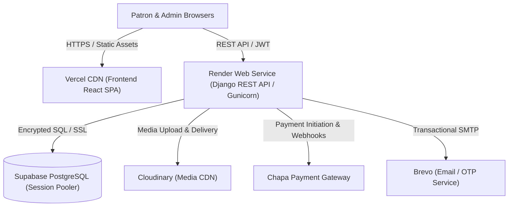

# Tilet3D — Haute Couture Ethiopian Fashion & 3D Avatar Fitting Room

<p align="center">
  
</p>

<p align="center">
  <strong>A modern luxury Ethiopian cultural clothing e-commerce platform featuring an interactive real-time 3D Avatar Fitting Room and an enterprise-grade administrative dashboard.</strong>
</p>

<p align="center">
  <a href="#key-features">Key Features</a> •
  <a href="#system-architecture">Architecture</a> •
  <a href="#admin-dashboard">Admin Dashboard</a> •
  <a href="#tech-stack">Tech Stack</a> •
  <a href="#getting-started">Getting Started</a> •
  <a href="#deployment">Deployment</a>
</p>

---

## Overview

**Tilet3D** bridges centuries of Ethiopian weaving heritage (*ጥበብ / Tibeb*) with cutting-edge 3D WebGL technology. The platform delivers an immersive haute couture shopping experience where patrons can customize anatomical 3D avatars, preview authentic traditional garments with real-time physics and lighting, and seamlessly complete secure checkout via national and international payment gateways.

---

## Key Features

### 1. Interactive 3D Avatar Fitting Room
- **Real-Time 3D Rendering**: Built with **Three.js**, **React Three Fiber (@react-three/fiber)**, **Drei**, and **Postprocessing**.
- **Anatomical Sizing & Rigging**: Custom bone transformation pipelines adjusting height, chest, waist, and hips.
- **Draco-Compressed GLB Models**: Optimized 3D assets (< 3MB) with automatic fallback previews for low-bandwidth devices.
- **Dynamic Lighting & Materials**: Studio stage lighting presets highlighting silk, velvet, and metallic embroidery textures.

### 2. Luxury Ethiopian Cultural Storefront
- **Cultural Identity**: Curated collections featuring Kemis, Habesha Tibeb, Suri Scarves, Men’s Gabi, and ceremonial couture.
- **Instant Search & Filters**: Multi-criteria catalog filtering by cultural region, garment type, fabric, and sizing.
- **Multilingual Ready**: Localization support via `i18next` for English, Amharic, Oromo, and French.
- **Patron Concierge**: AI-assisted styling advisor powered by **Google Gemini**.

### 3. Enterprise Admin Dashboard
A complete, security-hardened administrative suite across 11 operational modules:
- **Executive Overview**: Financial KPIs (net paid revenue, AOV), operational counters, and order funnel analytics.
- **Product Catalog Management**: Variant-level SKU tracking, Cloudinary media uploads, price matrices, and catalog activation.
- **Category & Collection Management**: Taxonomy control, cultural banners, and product associations.
- **Inventory Oversight**: Real-time physical, reserved, and available stock tracking with atomic reservation boundary guards.
- **Order Lifecycle & Fulfillment**: Multi-state order workflows (`pending` → `paid` → `processing` → `shipped` → `delivered`).
- **Customer Directory**: Privacy-conscious patron profiles, purchase history, and lifetime spend (ETB) tracking.
- **Payment Gateway Audit Feed**: Read-only transaction verification records with Chapa transaction references.
- **Business Analytics**: Server-side SQL aggregations of revenue volume, order status breakdowns, and top-selling garments.
- **Security Audit Logs**: Comprehensive chronological event stream tracking authentication, order modifications, and administrative actions.
- **Zero-Trust Settings**: Runtime telemetry and security posture oversight without exposing secrets or credentials.

### 4. Commerce & Security Architecture
- **JWT Authentication**: Concurrency-safe access & refresh token rotation with single in-flight deduplication and token blacklisting.
- **Chapa Payment Gateway**: Idempotent webhook verification, transaction signature validation, and instant client return verification.
- **Inventory Integrity**: Row-level locking (`SELECT FOR UPDATE`) prevents overselling during concurrent patron checkouts.
- **Cloudinary Integration**: Automated image optimization, WebP/AVIF dynamic delivery, and responsive transformations.

---

## Tech Stack

| Layer | Technologies |
| :--- | :--- |
| **Frontend** | React 19, TypeScript, Vite, Tailwind CSS, Zustand, Lucide Icons |
| **3D & WebGL** | Three.js, React Three Fiber, Drei, Postprocessing, Google Draco |
| **Backend** | Django 5.2, Django REST Framework, SimpleJWT, WhiteNoise, Gunicorn |
| **Database** | PostgreSQL (Supabase with SSL), Redis (Caching & Celery) |
| **Payments** | Chapa API (Ethiopian Birr & Cards) |
| **Media & Storage** | Cloudinary Media Storage |
| **AI Assistant** | Google Gemini (`google-genai`) |
| **Email & OTP** | Brevo SMTP |
| **Deployment** | Vercel (Frontend SPA), Render (Backend API), Supabase (PostgreSQL) |

---

## System Architecture



---

## Getting Started

### Prerequisites
- Node.js 20+ and npm
- Python 3.12+ and virtualenv
- PostgreSQL (or Supabase connection string)

### 1. Clone the Repository
```bash
git clone git@github.com:VICO-27/Tilet3D.git
cd Tilet3D
```

### 2. Backend Setup
```bash
cd backend
python3 -m venv venv
source venv/bin/activate
pip install -r requirements.txt

# Configure your environment
cp .env.example .env
# Edit .env with your PostgreSQL, Cloudinary, and Chapa credentials

# Run database migrations
python manage.py migrate

# Create initial staff superuser
python manage.py createsuperuser

# Start development server
python manage.py runserver
```

### 3. Frontend Setup
```bash
cd ../frontend
npm install

# Configure environment
cp .env.example .env

# Start Vite dev server
npm run dev
```

---

## Automated Testing Suite

The repository includes a comprehensive regression and unit test suite:

```bash
# Run backend test suite (37 tests)
cd backend && venv/bin/pytest tests/ -v

# Run frontend TypeScript type checking (0 errors)
cd frontend && ./node_modules/.bin/tsc --noEmit

# Run JWT refresh-token rotation regression tests (7/7 passed)
cd frontend && node tests/tokenRefresh.test.mjs

# Build production frontend bundle
cd frontend && npm run build
```

---

## Production Deployment

### Backend (Render)
- **Root Directory**: `backend`
- **Build Command**: `./build.sh`
- **Start Command**: `gunicorn config.wsgi:application`
- **Health Check**: `/health/`
- Set `DATABASE_URL` using the Supabase Connection Pooler (`aws-0-eu-west-1.pooler.supabase.com:5432`).

### Frontend (Vercel)
- **Root Directory**: `frontend`
- **Framework Preset**: `Vite`
- **Build Command**: `npm run build`
- **Output Directory**: `dist`
- Set `VITE_API_URL` to your live Render backend API (`https://<render-service>.onrender.com/api`).

---

## License

This project is created for portfolio presentation and demonstration purposes. All rights reserved.
